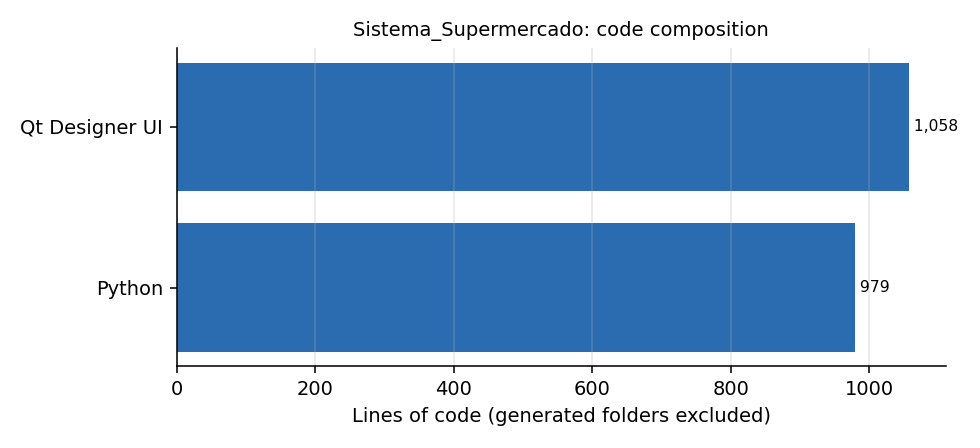

# Sistema_Supermercado

**Point-of-sale (PDV) screen for a small supermarket, in Python with PyQt5 and SQLite.** *Em portugues: tela de frente de caixa (PDV) com PyQt5 e banco SQLite.*

## What is in it

| File | What it is |
|---|---|
| `PDV2.py` | The PDV window built with Qt Designer and converted to Python: item grid (quantity, code, product, unit value, total), subtotal, discounts, surcharges, total to pay, receive-payment action, day of week and date, operator and profile, and menu entries to register products and users |
| `CriaBDSqlite.py` | Creates the SQLite database `SuperMarket.db` with the `Produto` table (id, code up to 14 characters, description, sale price, cost price) |
| `Imagens/` | Icons used by the interface |



## Run

```bash
pip install PyQt5
python CriaBDSqlite.py     # once, creates SuperMarket.db
python PDV2.py
```

## Status

The repository holds the **interface and the data model**: the checkout logic (reading the code, looking up the product, adding the line, totals, receiving payment) is not wired to the screen. It is the starting point of a POS, useful as a Qt layout reference. Build and packaging folders (PyInstaller) were removed from the repository.
